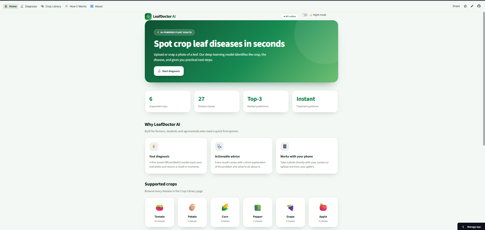
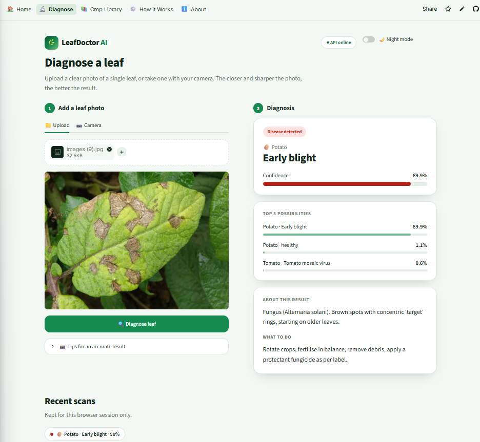
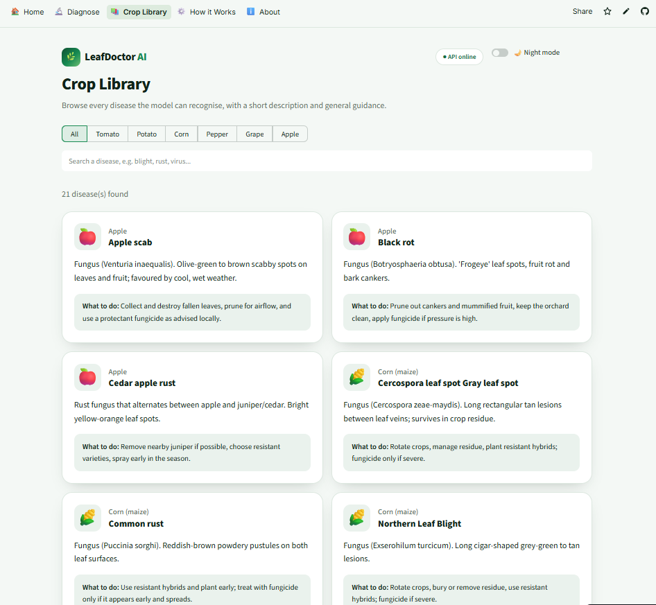
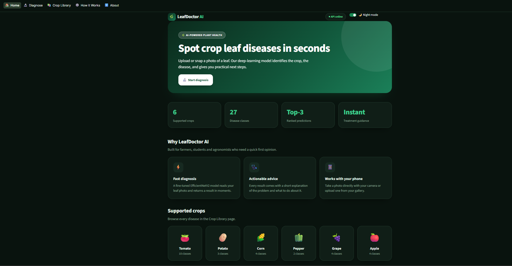

<div align="center">

# 🌿 LeafDoctor AI

**Crop leaf disease detection with deep learning.**
Upload a leaf photo, get the disease, confidence score and treatment advice in seconds.

[](https://leafdoctorai.streamlit.app/)


[**Live Demo**](https://leafdoctorai.streamlit.app/) · [Report a Bug](https://github.com/tanvir-50198/leafdoctor-ai/issues)

</div>

---

## 📸 Screenshots

<div align="center">

| Home | Diagnose |
|:---:|:---:|
|  |  |

| Diagnosis result | Crop Library |
|:---:|:---:|
|  |  |

| Night mode |
|:---:|
|  |

</div>

## ✨ Features

- **Instant diagnosis** from an uploaded image or a live camera photo
- **27 classes across 6 crops**: Tomato, Potato, Corn, Pepper, Grape, Apple
- **Top-3 predictions** with confidence bars
- **"Not sure" handling**: predictions under 60% confidence are flagged, with tips to retake the photo
- **Treatment guidance** for every detected disease
- **Crop Library**: searchable list of all diseases with descriptions and advice
- **Multipage website** with Home, Diagnose, Crop Library, How it Works and About pages
- **Light / Night theme** toggle
- **REST API** (FastAPI) with automatic docs at `/docs`

## 🧠 How it works


1. The image is resized to 224 × 224 and normalised with ImageNet statistics.
2. EfficientNetV2-S scores all 27 classes and softmax converts the scores to probabilities.
3. The API returns the top prediction, the top-3 list, a low-confidence flag, and short advice for the disease.

## 🌱 Supported crops

| Crop | Classes | Diseases |
|---|:---:|---|
| 🍅 Tomato | 10 | Bacterial spot, Early blight, Late blight, Leaf mold, Septoria leaf spot, Spider mites, Target spot, Yellow leaf curl virus, Mosaic virus, Healthy |
| 🥔 Potato | 3 | Early blight, Late blight, Healthy |
| 🌽 Corn | 4 | Gray leaf spot, Common rust, Northern leaf blight, Healthy |
| 🫑 Pepper | 2 | Bacterial spot, Healthy |
| 🍇 Grape | 4 | Black rot, Esca, Leaf blight, Healthy |
| 🍎 Apple | 4 | Apple scab, Black rot, Cedar apple rust, Healthy |

## 🏋️ Model and training

| | |
|---|---|
| **Architecture** | EfficientNetV2-S (ImageNet pre-trained, fine-tuned end to end) |
| **Dataset** | [PlantVillage](https://www.kaggle.com/datasets/abdallahalidev/plantvillage-dataset), 6 crops, 27 classes |
| **Split** | 80 / 10 / 10 (stratified train / validation / test) |
| **Input** | 224 × 224 RGB |
| **Optimiser** | AdamW with OneCycle learning-rate schedule |
| **Regularisation** | Label smoothing (0.1), weight decay, class-weighted loss |
| **Augmentation** | Random resized crop, flips, rotation, colour jitter, random erasing |
| **Hardware** | Google Colab GPU with mixed-precision (AMP) training |
| **Test accuracy** | **XX.X%** *(replace with your result from the notebook)* |

The full training pipeline is in [`training/train_colab.ipynb`](training/train_colab.ipynb).

## 🗂️ Project structure

```
leafdoctor-ai/
├── backend/
│   ├── main.py              # FastAPI app: /predict, /classes, /health
│   └── disease_info.py      # Disease descriptions and advice
├── frontend/
│   ├── app.py               # Streamlit entry point: navigation, theme, layout
│   ├── utils.py             # API calls and shared components
│   ├── style.css            # Design system (light / dark tokens)
│   └── views/               # home, diagnose, library, how_it_works, about
├── models/
│   ├── model.pt             # Trained weights
│   └── classes.json         # Class names
├── training/
│   └── train_colab.ipynb    # Training notebook (Google Colab)
├── docs/screenshots/        # README images
├── requirements-backend.txt
└── requirements-frontend.txt
```

## 🚀 Run locally

**Requirements:** Python 3.10+

```bash
git clone https://github.com/tanvir-50198/leafdoctor-ai.git
cd leafdoctor-ai

python -m venv venv
# Windows:      venv\Scripts\activate
# macOS/Linux:  source venv/bin/activate
```

**1. Backend** (terminal 1)

```bash
pip install -r requirements-backend.txt
cd backend
uvicorn main:app --reload --port 8000
```

API docs: http://localhost:8000/docs

**2. Frontend** (terminal 2)

```bash
pip install -r requirements-frontend.txt
cd frontend
streamlit run app.py
```

Open http://localhost:8501. If the backend runs elsewhere, set `API_URL`:

```bash
API_URL=https://your-backend-url streamlit run app.py
```

## 🔌 API

| Method | Endpoint | Description |
|---|---|---|
| `GET` | `/health` | Service status |
| `GET` | `/classes` | All classes with descriptions and advice |
| `POST` | `/predict` | Predict the disease from an uploaded image |

```bash
curl -X POST http://localhost:8000/predict -F "file=@leaf.jpg"
```

```json
{
  "prediction": {
    "crop": "Tomato",
    "disease": "Late blight",
    "healthy": false,
    "confidence": 0.9421,
    "low_confidence": false
  },
  "top3": [
    { "crop": "Tomato", "disease": "Late blight", "confidence": 0.9421 },
    { "crop": "Potato", "disease": "Late blight", "confidence": 0.0312 },
    { "crop": "Tomato", "disease": "Early blight", "confidence": 0.0108 }
  ],
  "info": {
    "about": "Oomycete (Phytophthora infestans). ...",
    "action": "Remove and destroy infected plants, ..."
  }
}
```

## ☁️ Deployment

- **Frontend:** Streamlit Community Cloud (`frontend/app.py`, requirements from `frontend/requirements.txt`). Set the `API_URL` secret to your backend URL.
- **Backend:** any host that runs Python, for example Render or Hugging Face Spaces.
  - Start command: `uvicorn main:app --app-dir backend --host 0.0.0.0 --port $PORT`
  - Use the CPU build of PyTorch to keep the install small (see `requirements-backend.txt`).
  - If `model.pt` is not in the repo, set `MODEL_URL` and `CLASSES_URL` and the backend will download them on startup.

## ⚠️ Limitations

- PlantVillage photos are mostly taken on plain backgrounds. **Accuracy on busy, real-field photos can be lower**, so always check the confidence score.
- Many images in the dataset come from the same leaf, so a random split gives slightly optimistic test numbers.
- The model only knows 6 crops and 27 classes. Any other plant will still receive a (wrong) answer.
- Results are a **first screening, not a final diagnosis.** Confirm with a local agriculture officer before applying any treatment.

## 🛣️ Roadmap

- [ ] Add rice and other Bangladesh-relevant crops
- [ ] Fine-tune on real field images (e.g. PlantDoc) for better robustness
- [ ] Grad-CAM heatmaps to show where the model looked
- [ ] Bangla language interface
- [ ] ONNX export for faster, lighter inference

## 👤 Author

**Abdur Rahman Tanvir**
CSE student, American International University-Bangladesh (AIUB)

[GitHub](https://github.com/tanvir-50198)

## 🙏 Acknowledgements

- [PlantVillage dataset](https://www.kaggle.com/datasets/abdallahalidev/plantvillage-dataset) (Hughes & Salathé)
- [PyTorch](https://pytorch.org/), [FastAPI](https://fastapi.tiangolo.com/) and [Streamlit](https://streamlit.io/)
